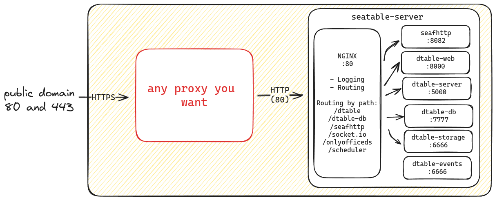
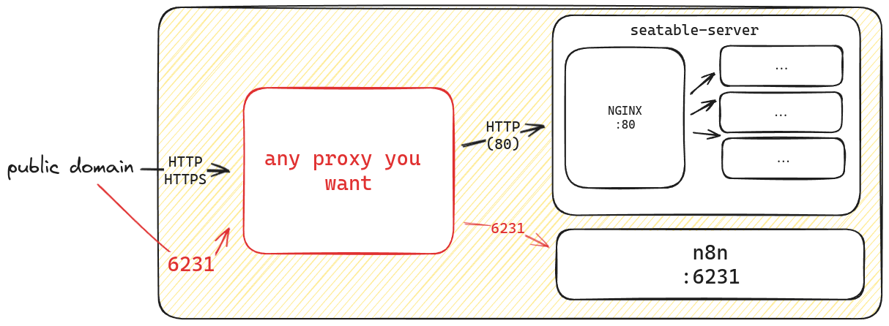
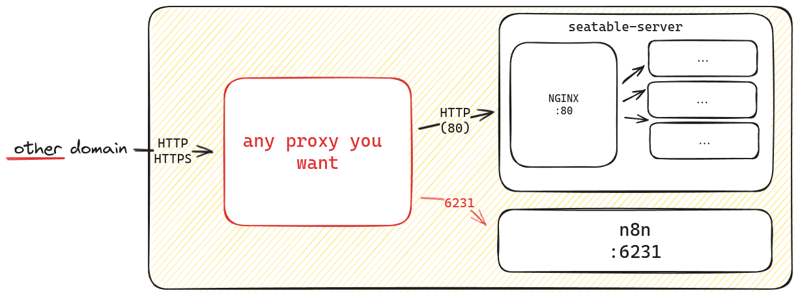

# Replace caddy with another proxy

The Single-Node Installation describes an installation of a SeaTable server with the webserver caddy. We decided to use Caddy because it simplifies the handling of let's encrypt certificates.
If you create a DNS entry and point it to your server, caddy will do everything else for you. Also we configured caddy with state of the art security configurations.

## Custom proxy with SeaTable Server

But of course there might be reasons when you want to replace caddy with another proxy like ha-proxy, traefik, nginx, apache etc. The logic of replacing might be simple.

You can use any proxy as long as your forward all traffic to the SeaTable Server. Part of the SeaTable Server container is a nginx web proxy, which routes the traffic by URL. **This port 80 is not exposed therefore your proxy has to be in the same docker network like SeaTable Server**.



## How to configure

Remove `caddy.yml` from COMPOSE_FILE from .env file. Restart all docker containers. Forward all traffic to the SeaTable Container via port 80.

!!! warning "SeaTable does not expose any ports"

    Please be aware that SeaTable does not expose port 80 to the outside. Therefore your proxy has to be in the same docker network. Otherwise you have to expose port 80 of SeaTable Server, see [Proxy outside of the docker network](#proxy-outside-of-the-docker-network).

## Required settings for your proxy

Caddy does more than forwarding requests. It also sets security headers and the `X-Forwarded-*` headers that SeaTable relies on. If you replace Caddy, **your proxy must do this**. Otherwise your installation is less secure, for example the login page can be embedded in other websites (clickjacking), and IP based rate limits can be bypassed.

The labels in `seatable-server.yml` are the reference for the required settings. Compare your proxy configuration with this file after each update.

**1. Forwarded headers**

| Header | Value | Why |
| --- | --- | --- |
| `Host` | the original host name | SeaTable builds links from it |
| `X-Forwarded-For` | the client IP address, **replace** an existing value | SeaTable uses it for logs, rate limits and IP restrictions. If your proxy appends to a header sent by the client (nginx: `$proxy_add_x_forwarded_for`), anyone can send a fake IP address. |
| `X-Forwarded-Proto` | `https` | SeaTable needs to know that the original request used https |

Your proxy must also support WebSocket connections. SeaTable uses them for real-time collaboration.

**2. Security headers**

Set these headers on all responses, including error responses:

- `Strict-Transport-Security`
- `Referrer-Policy`
- `X-Content-Type-Options`
- `X-Frame-Options`
- `Content-Security-Policy`

Use the values of the `caddy_0.header.*` labels in `seatable-server.yml`. Some pages must be embeddable in other websites, for example forms and external links. For these paths, `X-Frame-Options` and `Content-Security-Policy` must not be set:

- `/dtable/view-external-links/`
- `/dtable/external-links/`
- `/dtable/external-apps/`
- `/dtable/forms/`
- `/apps/custom/`
- `/external-apps/`

For `/dtable/external-apps-edit/`, only `Content-Security-Policy` must not be set.

**3. Cookies**

Caddy adds `Secure` and `SameSite=None` to all cookies. `Secure` makes sure that browsers send cookies only over https. `SameSite=None` is only needed if you use SAML or embed bases into other websites. Otherwise you can leave the default of SeaTable (`SameSite=Lax`), which gives better protection against cross-site requests.

**Example configuration for nginx**

This example shows the required settings for nginx. Replace the host name, the certificate paths and the Content-Security-Policy. It assumes that nginx runs in the same Docker network as SeaTable Server.

Create a file `seatable-headers.conf` with the headers that all paths get:

```nginx
add_header Strict-Transport-Security "max-age=31536000; includeSubDomains" always;
add_header Referrer-Policy "same-origin" always;
add_header X-Content-Type-Options "nosniff" always;
```

Then configure the server:

```nginx
map $http_upgrade $connection_upgrade {
    default upgrade;
    ''      close;
}

server {
    listen 443 ssl;
    server_name seatable.example.com;

    ssl_certificate     /etc/nginx/certs/seatable.crt;
    ssl_certificate_key /etc/nginx/certs/seatable.key;

    proxy_http_version 1.1;
    proxy_set_header Host              $host;
    proxy_set_header X-Forwarded-For   $remote_addr;
    proxy_set_header X-Forwarded-Proto $scheme;
    proxy_set_header Upgrade           $http_upgrade;
    proxy_set_header Connection        $connection_upgrade;
    proxy_read_timeout 1200s;
    client_max_body_size 0;

    # add "samesite=none" only if you use SAML or embed bases
    proxy_cookie_flags ~ secure;

    location / {
        include /etc/nginx/seatable-headers.conf;
        add_header X-Frame-Options "SAMEORIGIN" always;
        # copy the value from caddy_0.header.Content-Security-Policy in seatable-server.yml
        add_header Content-Security-Policy "..." always;
        proxy_pass http://seatable-server:80;
    }

    # app editor: frame protection, but no Content-Security-Policy
    location /dtable/external-apps-edit/ {
        include /etc/nginx/seatable-headers.conf;
        add_header X-Frame-Options "SAMEORIGIN" always;
        proxy_pass http://seatable-server:80;
    }

    # pages that can be embedded in other websites
    location ~ ^/(dtable/(view-external-links|external-links|external-apps|forms)|apps/custom|external-apps)/ {
        include /etc/nginx/seatable-headers.conf;
        proxy_pass http://seatable-server:80;
    }
}
```

!!! warning "nginx only inherits add_header if a location has none"

    If a `location` block contains an `add_header` directive, nginx ignores all `add_header` directives of the `server` block. This is why every `location` includes `seatable-headers.conf`.

**Check the result**

```bash
curl -sI https://seatable.example.com/accounts/login/ | grep -i -E "strict|referrer|nosniff|x-frame|content-security"
curl -sI https://seatable.example.com/does-not-exist | grep -i strict
```

All five headers must be present on the login page, and `Strict-Transport-Security` also on the 404 page.

## Custom proxy with additional components

For the additional components you can choose between two different options. You can access the services either via separate port or (sub)domain.

### Option 1: use ports to access the services

The additional components run on separate ports. n8n uses the port 6231. If you only have one public domain available, you can forward the required port to the internal network and access the service. This does not require any further configuration.



### Option 2: other domains to access the services

In this case, you use another (sub)domain to access the service. You create a proxy rule to route the traffic to the service with its internal port. Usually this requires that you also change the configuration of the service to be accessible via this additional domain.



## Proxy outside of the docker network

To use a proxy outside of your Docker network, you have to publish port 80 of SeaTable Server. Do this in a `custom-seatable-server.yml` file and add it to the `COMPOSE_FILE` variable in your `.env` file (see [Customizations](../../configuration/customizations.md)).

!!! danger "Never publish port 80 to all interfaces"

    Docker bypasses the firewall of your host for published ports. With `ports: - 80:80`, everyone can reach SeaTable directly, without your proxy, its security headers and its https. Anyone can also send a fake `X-Forwarded-For` header.

    Always bind the port to a specific address:

    - Your proxy runs on the **same host**: bind the port to `127.0.0.1`.
    - Your proxy runs on **another host**: bind the port to the internal IP address of your server and allow access only from your proxy, for example in the `DOCKER-USER` chain of your firewall.

```yaml
# custom-seatable-server.yml
---
services:
  seatable-server:
    ports:
      # proxy on the same host
      - "127.0.0.1:8080:80"
      # or: proxy on another host, use the internal IP address of this server
      # - "10.0.0.5:8080:80"
```

Your proxy then forwards all traffic to this address and port. The [required settings](#required-settings-for-your-proxy) apply in the same way.

Because network configurations vary widely, it’s difficult to provide specific instructions for every setup. This approach requires familiarity with networking and routing concepts.
